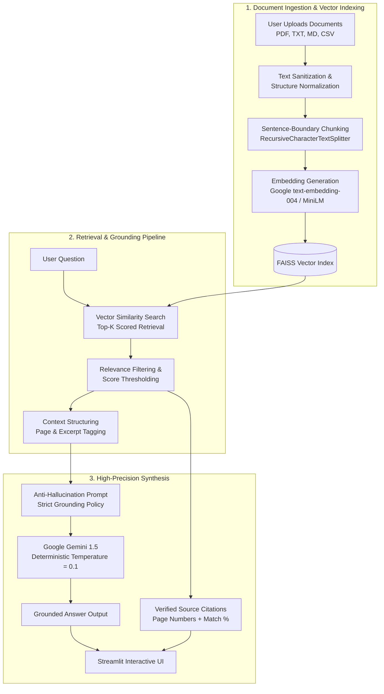

# 📚 RAG: High-Precision Document QA Intelligence.

[](https://www.python.org/)
[](https://streamlit.io/)
[](https://www.langchain.com/)
[](https://github.com/facebookresearch/faiss)
[](https://aistudio.google.com/)
[](https://www.docker.com/)

**NexusRAG** is a production-grade, enterprise-ready Retrieval-Augmented Generation (RAG) platform designed to deliver **maximum factual precision and zero-hallucination document question answering**. Powered by **Google Gemini 1.5**, **FAISS vector indexing**, and **LangChain Expression Language (LCEL)**, it guarantees strict source verification with page-level citations and confidence scoring.

---

## 🏛️ System Architecture



---

## 🎯 How Near-100% Accuracy is Guaranteed

NexusRAG employs a multi-tiered accuracy defense architecture:

1. **Strict Context-Grounded Prompting**: The system prompt strictly prohibits extrapolating or injecting external knowledge. If the answer cannot be directly proven from the text, the model truthfully states so rather than guessing.
2. **Deterministic Sampling**: The default temperature is calibrated to `0.1` (or `0.0`), preventing stochastic drift and creative hallucinations.
3. **Sentence-Preserving Semantic Chunking**: Chunking respects sentence boundaries (`\n\n`, `. `, `? `, `! `) rather than splitting mid-sentence, preventing fragmented information loss.
4. **Relevance Score Normalization**: Every retrieved passage is scored against the question, filtering out noisy chunks and displaying verified match percentages (e.g. `96.4% Match`).
5. **Direct Source & Page Attribution**: Every response includes an expandable drawer showing the exact file name, page number, and verbatim text excerpt used to formulate the answer.

---

## ✨ Key Features

- **Multi-Format Ingestion**: Supports `.pdf` (page-by-page extraction), `.txt`, `.md`, and `.csv`.
- **Dual Embedding Engines**:
  - *Google text-embedding-004* (State-of-the-art 768-dim precision with zero local overhead - Recommended).
  - *HuggingFace all-MiniLM-L6-v2* (Local offline embeddings).
- **Flagship Reasoning Models**: Seamlessly toggle between `gemini-1.5-flash`, `gemini-1.5-pro` (maximum reasoning capability), and `gemini-2.0-flash`.
- **Multi-Turn Conversational Memory**: Remembers context across questions for natural follow-up inquiries.
- **Starter Question Prompts**: Instant 1-click exploratory queries (Summarize, Extract key metrics, List limitations).
- **Export Transcripts**: One-click JSON export of your complete QA dialogue and citations.
- **Enterprise UI**: Dark-mode glassmorphic interface with interactive badges and citation inspection.

---

## 🚀 Quick Start (Local Setup)

### 1. Clone the Repository
```bash
git clone https://github.com/utkarshpatel7x/RAG-Model.git
cd RAG-Model
```

### 2. Create and Activate Virtual Environment
```bash
# Windows
python -m venv .venv
.\.venv\Scripts\activate

# macOS / Linux
python3 -m venv .venv
source .venv/bin/activate
```

### 3. Install Dependencies
```bash
pip install -r requirements.txt
```

### 4. Configure Your API Key
Get your free API key from [Google AI Studio](https://aistudio.google.com/).

You can provide it in any of three ways:
1. **Interactive UI**: Paste directly into the sidebar in the app.
2. **Environment File**:
   ```bash
   cp .env.example .env
   # Edit .env and paste: GOOGLE_API_KEY=your_actual_key_here
   ```
3. **Streamlit Secrets**: Create `.streamlit/secrets.toml`:
   ```toml
   GOOGLE_API_KEY = "your_actual_key_here"
   ```

### 5. Run the Application
```bash
streamlit run app.py
```
*(Or run `streamlit run prj.py` for backward-compatible execution)*

Access the application in your browser at `http://localhost:8501`.

---

## 🐳 Docker Deployment

Run anywhere with Docker in seconds:

### Using Docker Compose (Recommended)
```bash
# 1. Create your .env file
echo "GOOGLE_API_KEY=your_key_here" > .env

# 2. Build and launch
docker compose up --build
```

### Using Standard Docker CLI
```bash
# Build Docker image
docker build -t nexus-rag:latest .

# Run Docker container
docker run -d -p 8501:8501 -e GOOGLE_API_KEY="your_key_here" --name nexus_rag nexus-rag:latest
```

---

## ☁️ Cloud Deployment Options

### Option A: Streamlit Community Cloud (Free & Easiest)
1. Fork or push this repository to GitHub.
2. Go to [share.streamlit.io](https://share.streamlit.io/).
3. Connect your GitHub account and select your repository:
   - **Main file path**: `app.py`
4. In **Advanced Settings > Secrets**, add:
   ```toml
   GOOGLE_API_KEY = "your_actual_gemini_api_key"
   ```
5. Click **Deploy**!

### Option B: Render / Railway / Google Cloud Run
- Deploy directly from the included `Dockerfile`.
- Set Environment Variable: `GOOGLE_API_KEY`.
- Set Port: `8501`.

### Option C: Hugging Face Spaces
1. Create a new Space with the **Streamlit** SDK.
2. Push this repository to your Space.
3. Add your `GOOGLE_API_KEY` under Space **Settings > Variables and secrets**.

---

## 📁 Project Structure

```
RAG-Model/
├── .streamlit/
│   ├── config.toml           # Theme, max upload size, server configuration
│   └── secrets.toml.example  # Secrets template for Streamlit Cloud
├── src/
│   ├── __init__.py           # Package marker
│   ├── config.py             # Model configs, defaults & API key resolution
│   ├── document_loader.py    # Multi-format document extractor & text sanitizer
│   ├── embeddings.py         # Google & HuggingFace embedding factory
│   ├── vector_store.py       # FAISS vector store with relevance scoring
│   └── rag_engine.py         # High-precision LCEL RAG engine & prompt guardrails
├── app.py                    # Modern Streamlit UI & interactive chat interface
├── prj.py                    # Backward-compatible entry launcher
├── requirements.txt          # Production dependencies
├── Dockerfile                # Production container specification
├── docker-compose.yml        # Docker Compose configuration
├── .dockerignore             # Container build filter
├── .gitignore                # Git hygiene & secret protection
├── .env.example              # Environment variables template
└── README.md                 # Complete documentation
```

---

## 🛡️ License

This project is licensed under the [MIT License](LICENSE).
